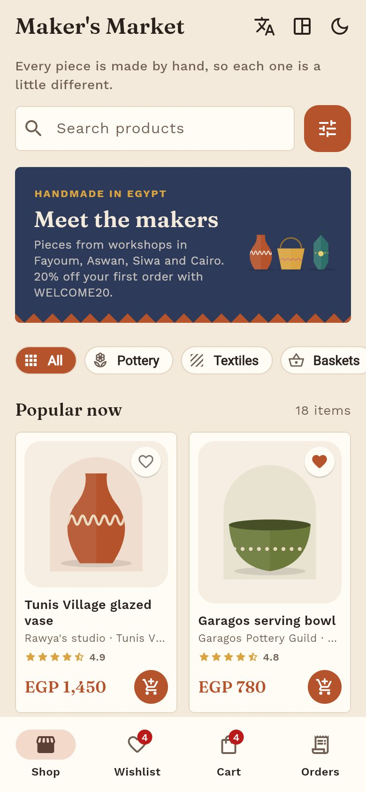
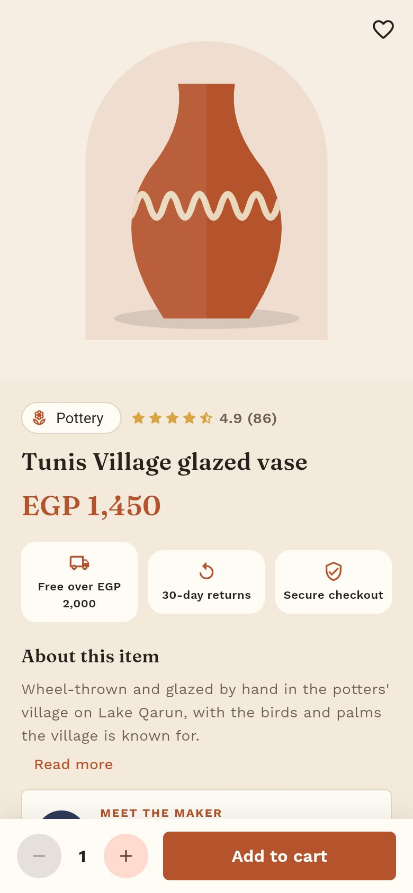
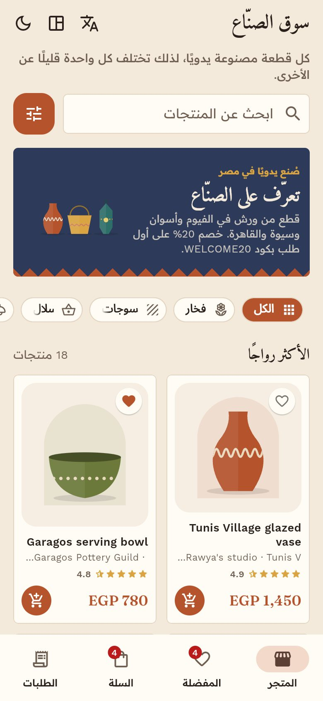

# The Maker's Market

[](https://github.com/EyadOraby/makers-market/actions/workflows/flutter.yml)

A Flutter store for Egyptian handmade crafts: pottery from Fayoum and Garagos, Akhmim weaving, Siwa embroidery, Nubian baskets and Cairo brass lanterns. Every piece names the workshop and town it comes from. English and Arabic, light and dark, phone to desktop.

**Try it in the browser:** [eyadoraby.github.io/makers-market](https://eyadoraby.github.io/makers-market/)

| Shop | Product | Arabic |
|---|---|---|
|  |  |  |

Formerly *Mini Shop*. It was rebranded in November 2026 with its own identity; see [docs/BRAND.md](docs/BRAND.md).

## Features

- **Storefront** with search, six craft categories, sorting, a "Meet the makers" banner and a responsive grid
- **Product art drawn in code** (`lib/widgets/craft_art.dart`): one cut-paper style for every piece, no stock photos
- **Product details** with rating, perks, description, a "Meet the maker" card, a quantity stepper and "You may also like"
- **Wishlist** saved on the device
- **Cart** with steppers, swipe to remove with undo, free shipping over EGP 2,000, promo codes (`MAKERS10`, `WELCOME20`) and a summary
- **Checkout** in three steps (delivery details, cash or card demo, review), then a confirmation
- **Orders** with a processing, shipped and delivered timeline, and an **owner's dashboard** with revenue, orders and sales by category
- **English and Arabic** with a right-to-left layout; **dark mode**, remembered between visits
- **Works offline**: the catalogue is published with the site (`site/api/products.json`), so the app loads it live, then falls back to the last good copy and then to the bundled one
- On the web, `?demo=1` fills the cart, wishlist and orders; `?screen=cart`, `?screen=product&id=5` or `?screen=admin` open a screen; `?lang=ar` opens in Arabic

The workshops in the demo catalogue are fictional; the towns and their crafts are real. `tool/make_catalog.py` regenerates the catalogue.

## Architecture

```
lib/
  app/           brand theme (light and dark) and Arabic strings
  core/          KeyValueStore: Hive in the app, in memory in tests
  logic/         CartSummary: subtotal, promo discount, shipping and total
  cubits/        products, cart, wishlist, orders and theme (flutter_bloc)
  repositories/  ProductRepository with API, cache and bundled fallbacks
  models/        Product, CartItem, Order
  screens/       shell, shop, details, cart, checkout, orders and wishlist
  widgets/       product card, rating stars, quantity stepper, empty states
```

Screens only talk to cubits; cubits keep state and save it through `KeyValueStore`, so every rule (pricing, promo codes, cart changes, order history, fallbacks) is tested without a device.

## Tests and CI

`flutter test` covers the catalog (search, categories, sorting, retries and offline fallbacks), pricing and promo codes, the cart, wishlist, orders, theme and checkout validation. GitHub Actions runs `flutter analyze`, the tests and a web build on every pull request, and publishes the web demo to GitHub Pages from `main`.

## Run it

```bash
flutter pub get
flutter run            # a device or emulator
flutter run -d chrome  # the web version
```

Requires Flutter with Dart 3.5 or later.
